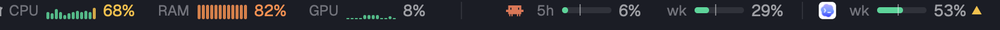
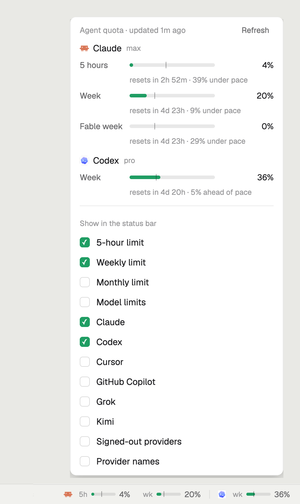

# Agent quota and system load for Herdr

Your coding agents' usage limits in the [Herdr](https://herdr.dev) status bar: one slim bar per
limit, so Claude's 5-hour and weekly limits show side by side. Quiet until it matters: bars turn
amber at 60%, orange at 80% and red at 92%. Click it for details and options.

Optional second mod: live CPU, RAM and GPU load beside it, so you do not need Activity Monitor
to see what your agents do to your Mac. See [System load](#system-load-optional-second-mod).





- **Every limit at a glance:** Claude 5-hour and weekly, Codex weekly, and any other provider
  [`quota-axi`](https://github.com/kunchenguid/quota-axi) knows (Cursor, GitHub Copilot, Grok, Kimi).
- **Pace:** a thin tick on each bar marks how much of the window has passed. A small ▲ means you
  are using it faster than the clock.
- **Popup:** reset times, "ahead of pace" or "under pace", and options for what the bar shows:
  5-hour, weekly, monthly and per-model limits, each provider, signed-out providers, names.
- Follows your Herdr theme, light and dark.

## Requirements

- The Herdr desktop app (`herdr-app`).
- [`quota-axi`](https://github.com/kunchenguid/quota-axi) by
  [kunchenguid](https://github.com/kunchenguid), which reads the quota:

  ```sh
  npm install -g quota-axi
  quota-axi            # check that it sees your providers
  ```

## Install

1. Copy `mods/quota` to `~/.config/herdr-app/mods/quota`.
2. Herdr's own layouts are read-only, so clone one and put the quota block in its status bar.
   Clone `main` (this switches to the clone):

   ```sh
   herdr-app do layout.clone '{"name":"main","as":"main-plus"}'
   ```

3. In `~/.config/herdr-app/layouts/main-plus.json`, replace the status block

   ```json
   { "id": "status", "type": "block", "content": { "mod": "workspace-status" }, "size": { "px": 28 } }
   ```

   with a row that holds both:

   ```json
   { "id": "status", "type": "row", "size": { "px": 28 }, "resizable": false, "children": [
     { "id": "status-main", "type": "block", "content": { "mod": "workspace-status" }, "size": { "weight": 1 } },
     { "id": "status-quota", "type": "block", "content": { "mod": "quota" }, "size": { "px": 360 } }
   ] }
   ```

4. Check it: `herdr-app check ~/.config/herdr-app/mods/quota`.

Or ask the agent running in Herdr: "add the herdr.dev mod Lakris2407/herdr-quota".

## Options

Click or right-click the bar to choose what it shows; choices are saved. A layout can set the
starting options with `props`, for example to hide a provider:

```json
"content": { "mod": "quota", "props": { "hidden": ["cursor"] } }
```

`props` takes `hidden` (provider ids), `kinds` (`{ "session": true, "weekly": true, "monthly": true, "model": false }`),
`signedOut`, `names` and `remaining` (default `false`).

Enable **Show remaining instead of used** in the popup to switch the percentages and bar fills
in both views. Colors and pace warnings still reflect usage, so nearly exhausted limits stay red.
Used-share windows stay labeled as used because they are not independent allowances.

Keys: bind `quota:menu` (open the popup) and `quota:refresh` (read now) in `keys.json`.

## What it runs

The mod runs `quota-axi --json` every 2 minutes, and when you click Refresh. If Herdr cannot find
it on its own `PATH` (common when Herdr starts from the Dock), it asks your login shell
(`$SHELL -lic`). The mod itself makes no network requests and stores no tokens; `quota-axi` reads
your local Claude, Codex and other CLI sign-ins to ask each provider for your usage.

## System load (optional second mod)

`mods/system` shows CPU, memory and GPU load next to the quota: a small live graph of the last
36 seconds and the percent for each, in the same green, amber, orange and red scale. Hover for
details (user and system CPU, GB of memory used); click to open Activity Monitor. macOS only.

It reads `iostat`, `vm_stat`, `sysctl` and `ioreg` every 3 seconds; none need root. Memory is
Activity Monitor's "Memory Used" (app memory, wired and compressed).

Install: copy `mods/system` to `~/.config/herdr-app/mods/system` and add a block before
`status-quota` in the status row:

```json
{ "id": "status-system", "type": "block", "content": { "mod": "system" }, "size": { "px": 330 } }
```

## Credits

- Quota data: [quota-axi](https://github.com/kunchenguid/quota-axi) by kunchenguid (MIT).
- Provider icons: the ones Herdr ships in `~/.config/herdr-app/icons`; this repo includes none.
- Built on the [Herdr](https://github.com/herdrdev/herdr-app) mod API.

## License

MIT
